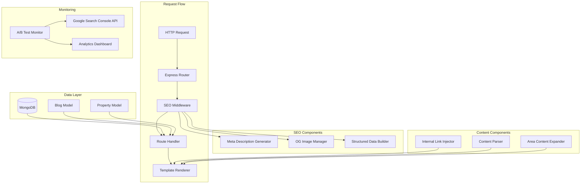

# Design Document: SEO and UX Improvements

## Overview

This design document specifies the technical implementation for comprehensive SEO and UX improvements to the Vancouver Luxury Rentals (VLR) property rental website. The system will enhance search engine visibility (both traditional and AI-powered), improve conversion rates for property owner sign-ups, and optimize user experience while maintaining complete backward compatibility with existing functionality.

### Business Context

VLR serves two primary audiences:
1. **Property Owners** - Landlords seeking professional property management services
2. **Tenants** - Individuals searching for rental properties in Vancouver

Current audit findings reveal critical SEO deficiencies:
- Duplicate meta descriptions across all pages
- Tenant-first navigation architecture misaligned with business priorities
- Thin content on area pages (insufficient for AI search indexing)
- Missing blog infrastructure for fresh content and thought leadership
- Inconsistent Open Graph images for social sharing
- No internal linking strategy between related pages

### AI Search Optimization Priority

A primary design goal is optimizing for AI-based search engines (ChatGPT, Perplexity, Claude, Google AI Overviews). AI systems evaluate websites based on:
- **Content depth and comprehensiveness** (600+ words per area page)
- **Semantic structure** (proper H1 → H2 → H3 hierarchy)
- **Information clarity** (unique meta descriptions, structured data)
- **Contextual richness** (detailed neighbourhood information, market insights)

The current low audit scores indicate the site is not being referenced by AI search systems when users ask about Vancouver property management.

### Design Principles

1. **Backward Compatibility First** - All existing routes, database queries, templates, and user workflows must remain functional
2. **Follow Existing Patterns** - Extend the `buildPropertiesSeo()` pattern from `routes/properties.js` for consistency
3. **Middleware-Based Enhancement** - Use Express middleware to inject SEO data without modifying core route logic
4. **Template Extension** - Enhance existing EJS templates by adding optional variables, never removing existing ones
5. **Performance Preservation** - Page load times must not increase by more than 100ms

## Architecture

### High-Level Component Diagram



### System Context

The VLR application is a Node.js/Express application with:
- **Backend**: Express.js with EJS templating
- **Database**: MongoDB with Mongoose ODM
- **Storage**: AWS S3 for property images
- **Session Management**: express-session with MongoDB store
- **Authentication**: Passport.js with local strategy

### Integration Points

1. **Existing SEO Infrastructure**
   - `routes/properties.js` contains `buildPropertiesSeo()` function
   - `views/header.ejs` supports `seoTitle`, `seoDescription`, `canonicalUrl`, `ogImage`, `structuredData`
   - Property listings already generate structured data for search engines

2. **Route Structure**
   - `/` - Homepage
   - `/properties` - Property search and listings
   - `/owners` - Owner landing page
   - `/owners/*` - Owner service pages
   - `/tenants` - Tenant landing page
   - `/about` - Company information
   - `/property-management-*` - Area-specific landing pages

3. **Template System**
   - All pages include `header.ejs` and `footer.ejs`
   - `navigationBar.ejs` renders main navigation
   - Templates use Vue.js for client-side interactivity

## Components and Interfaces

### 1. Meta Description Generator (`lib/seoHelpers.js`)

**Purpose**: Generate unique, contextually relevant meta descriptions for each page type.

**Interface**:
```javascript
/**
 * Generate SEO metadata for a given page context
 * @param {Object} context - Page context object
 * @param {string} context.pageType - Type of page (homepage, owners, area, property, blog)
 * @param {Object} context.data - Page-specific data
 * @returns {Object} SEO metadata object
 */
function generateSeoMetadata(context) {
  return {
    seoTitle: string,
    seoDescription: string,
    canonicalUrl: string,
    ogImage: string,
    structuredData: array
  };
}
```

**Implementation Strategy**:

```javascript
// Page type handlers
const metaGenerators = {
  homepage: (data) => ({
    seoTitle: 'VancouverLuxuryRentals: Search Luxury Furnished and Unfurnished Rental Listings in Vancouver',
    seoDescription: 'Browse luxury rental properties in Vancouver. Professional property management services for owners and premium rentals for tenants.',
    canonicalUrl: 'https://www.vancouverluxuryrentals.com/'
  }),
  
  owners: (data) => ({
    seoTitle: 'Professional Property Management Services in Vancouver | VLR',
    seoDescription: 'BCREA-licensed property management with tenant screening, rent collection, and 24/7 support. Maximize your rental income with VLR.',
    canonicalUrl: 'https://www.vancouverluxuryrentals.com/owners'
  }),
  
  area: (data) => {
    const city = data.city || 'Vancouver';
    return {
      seoTitle: `${city} Property Management & Rental Listings | VLR`,
      seoDescription: `Professional property management in ${city}. Browse available rentals and learn about the local rental market. BCREA-licensed agents.`,
      canonicalUrl: `https://www.vancouverluxuryrentals.com/property-management-${toSlug(city)}`
    };
  },
  
  property: (data) => {
    const prop = data.property;
    const address = prop.address || 'Property';
    const city = prop.city || 'Vancouver';
    const beds = prop.bedrooms || '0';
    const baths = prop.bathrooms || '0';
    const rent = prop.rent ? `$${prop.rent}` : 'Contact for pricing';
    
    return {
      seoTitle: `${address} - ${beds} Bed ${baths} Bath in ${city} | VLR`,
      seoDescription: `${prop.typeOfProperty || 'Property'} for rent in ${city}. ${beds} bedrooms, ${baths} bathrooms, ${prop.squareFeet || 'N/A'} sqft. ${rent}/month.`,
      canonicalUrl: `https://www.vancouverluxuryrentals.com/listing/${toSlug(address)}-property-id-${prop.propertyId}`
    };
  },
  
  blog: (data) => {
    const post = data.post;
    const excerpt = post.excerpt || post.content.substring(0, 150);
    
    return {
      seoTitle: `${post.title} | VLR Blog`,
      seoDescription: sanitizeForMeta(excerpt),
      canonicalUrl: `https://www.vancouverluxuryrentals.com/blog/${post.slug}`
    };
  }
};

// Sanitize text for meta description
function sanitizeForMeta(text) {
  return text
    .replace(/<[^>]*>/g, '') // Remove HTML tags
    .replace(/&[^;]+;/g, '') // Remove HTML entities
    .replace(/\s+/g, ' ') // Normalize whitespace
    .trim()
    .substring(0, 158); // Enforce max length
}

// Ensure length constraints
function enforceMetaLength(description) {
  if (description.length < 120) {
    console.warn('Meta description too short:', description.length);
  }
  if (description.length > 158) {
    return description.substring(0, 155) + '...';
  }
  return description;
}
```

**Character Encoding Handling**:
- Strip HTML tags and entities
- Normalize whitespace
- Truncate at 158 characters with ellipsis if needed
- Warn if description is under 120 characters

### 2. SEO Middleware (`middlewares/seo.js`)

**Purpose**: Inject SEO metadata into request context before route handlers execute.

**Interface**:
```javascript
/**
 * Middleware to attach SEO metadata to res.locals
 * @param {Object} options - Configuration options
 * @param {string} options.pageType - Page type identifier
 * @param {Function} options.dataExtractor - Function to extract data from req
 */
function seoMiddleware(options) {
  return function(req, res, next) {
    const context = {
      pageType: options.pageType,
      data: options.dataExtractor ? options.dataExtractor(req) : {}
    };
    
    const seoData = generateSeoMetadata(context);
    
    // Attach to res.locals for template access
    Object.assign(res.locals, seoData);
    
    next();
  };
}
```

**Usage Example**:
```javascript
// In routes/owners.js
const seoMiddleware = require('../middlewares/seo');

router.get('/', 
  seoMiddleware({ pageType: 'owners' }),
  function(req, res) {
    res.render('owners.ejs');
    // Template automatically receives seoTitle, seoDescription, etc.
  }
);
```

### 3. Area Content Expander (`lib/areaContent.js`)

**Purpose**: Generate comprehensive, SEO-optimized content for neighbourhood and area pages.

**Interface**:
```javascript
/**
 * Generate expanded content for an area page
 * @param {string} city - City/neighbourhood name
 * @param {Object} marketData - Optional market data
 * @returns {Object} Content sections
 */
function generateAreaContent(city, marketData = {}) {
  return {
    overview: string,        // 150-200 words
    rentalMarket: string,    // 150-200 words
    ownerValue: string,      // 100-150 words
    neighbourhood: string,   // 100-150 words
    faq: array,             // 3-4 Q&A pairs
    cta: string             // Call to action text
  };
}
```

**Content Structure**:


```javascript
const areaContentTemplates = {
  overview: (city) => `
    ${city} offers diverse rental opportunities for property owners and tenants. 
    As one of Vancouver's premier neighbourhoods, ${city} combines [unique characteristics] 
    with strong rental demand. Vancouver Luxury Rentals provides comprehensive property 
    management services throughout ${city}, helping owners maximize returns while 
    maintaining high tenant satisfaction.
  `,
  
  rentalMarket: (city, data) => `
    The ${city} rental market shows [current trends]. Average rental rates for 
    [property types] range from [price range]. Vacancy rates remain [low/moderate/high], 
    indicating [strong/moderate] demand. Property owners benefit from [market advantages]. 
    Our BCREA-licensed agents monitor market conditions daily to optimize rental pricing.
  `,
  
  ownerValue: (city) => `
    Property owners in ${city} choose VLR for professional tenant screening, 
    rent collection, and property maintenance coordination. Our local expertise 
    ensures competitive rental rates while minimizing vacancy periods. We handle 
    all aspects of property management, from marketing to lease enforcement.
  `,
  
  neighbourhood: (city, data) => `
    ${city} features [transit options], [amenities], and [demographics]. 
    Residents enjoy access to [local attractions]. The area attracts [tenant types], 
    making it ideal for [property types]. Proximity to [landmarks] enhances rental appeal.
  `,
  
  faq: (city) => [
    {
      question: `What are typical rental rates in ${city}?`,
      answer: `Rental rates in ${city} vary by property type. One-bedroom condos typically range from $X,XXX-$X,XXX, while houses command $X,XXX-$X,XXX monthly. Contact VLR for a free rental assessment.`
    },
    {
      question: `How long does it take to find tenants in ${city}?`,
      answer: `Well-priced properties in ${city} typically lease within 2-4 weeks. VLR's marketing reach and professional photography accelerate the process.`
    },
    {
      question: `What property management services does VLR offer in ${city}?`,
      answer: `VLR provides full-service property management including tenant screening, rent collection, maintenance coordination, and legal compliance. All agents are BCREA-licensed.`
    }
  ]
};
```

**Content Generation Process**:
1. Load city-specific data from configuration or database
2. Apply content templates with city-specific variables
3. Validate minimum word count (600 words total)
4. Inject internal links to owner landing page and related areas
5. Structure with proper heading hierarchy (H1 → H2 → H3)

### 4. Internal Link Injector (`lib/internalLinks.js`)

**Purpose**: Automatically insert contextual internal links between related pages.

**Interface**:
```javascript
/**
 * Inject internal links into content
 * @param {string} content - HTML content
 * @param {Object} options - Link injection options
 * @param {string} options.pageType - Current page type
 * @param {Array} options.targetPages - Pages to link to
 * @returns {string} Content with injected links
 */
function injectInternalLinks(content, options) {
  // Parse content, identify insertion points, inject links
  return modifiedContent;
}
```

**Link Injection Rules**:


```javascript
const linkInjectionRules = {
  area: {
    targets: [
      { url: '/owners', anchor: 'property management services', maxOccurrences: 1 },
      { url: '/owners/list-properties', anchor: 'list your property', maxOccurrences: 1 }
    ],
    insertionPoints: ['p:nth-of-type(2)', 'p:nth-of-type(4)'] // After 2nd and 4th paragraphs
  },
  
  owners: {
    targets: [
      { url: '/property-management-vancouver', anchor: 'Vancouver property management', maxOccurrences: 1 },
      { url: '/property-management-north-vancouver', anchor: 'North Vancouver', maxOccurrences: 1 },
      { url: '/property-management-burnaby', anchor: 'Burnaby', maxOccurrences: 1 }
    ],
    insertionPoints: ['p:nth-of-type(3)']
  },
  
  blog: {
    targets: [
      { url: '/owners', anchor: 'property management', maxOccurrences: 2 },
      { url: '/properties', anchor: 'rental listings', maxOccurrences: 1 }
    ],
    insertionPoints: ['p:nth-of-type(2)', 'p:nth-of-type(5)']
  }
};

// Link injection algorithm
function injectLinks(content, rules) {
  const $ = cheerio.load(content);
  const injected = new Set();
  
  rules.targets.forEach(target => {
    let occurrences = 0;
    
    rules.insertionPoints.forEach(selector => {
      if (occurrences >= target.maxOccurrences) return;
      
      const $element = $(selector);
      if ($element.length && !$element.find('a').length) {
        // Only inject if no existing links in this element
        const text = $element.text();
        if (text.includes(target.anchor) && !injected.has(target.url)) {
          const linkedText = text.replace(
            target.anchor,
            `<a href="${target.url}">${target.anchor}</a>`
          );
          $element.html(linkedText);
          injected.add(target.url);
          occurrences++;
        }
      }
    });
  });
  
  return $.html();
}
```

**Safety Constraints**:
- Never inject links inside existing `<a>` tags
- Never inject links inside `<h1>`, `<h2>`, `<h3>` tags
- Limit to one link per target URL per page
- Preserve existing HTML structure and attributes

### 5. Blog System Components

#### Blog Model (`models/blog.js`)

**Schema**:
```javascript
const BlogSchema = new mongoose.Schema({
  title: { type: String, required: true },
  slug: { type: String, required: true, unique: true },
  content: { type: String, required: true },
  excerpt: { type: String },
  author: { type: String, required: true },
  category: { type: String, enum: ['owners', 'tenants', 'market', 'guides'], required: true },
  tags: [{ type: String }],
  publishDate: { type: Date },
  status: { type: String, enum: ['draft', 'scheduled', 'published'], default: 'draft' },
  featuredImage: { type: String },
  metaDescription: { type: String },
  createdAt: { type: Date, default: Date.now },
  updatedAt: { type: Date, default: Date.now }
});

BlogSchema.index({ slug: 1 });
BlogSchema.index({ publishDate: -1 });
BlogSchema.index({ category: 1, status: 1 });
```

#### Blog Routes (`routes/blog.js`)

**Public Routes**:
```javascript
// Blog index - paginated list
router.get('/blog', function(req, res) {
  const page = parseInt(req.query.page) || 1;
  const limit = 10;
  
  BlogModel.find({ status: 'published', publishDate: { $lte: new Date() } })
    .sort('-publishDate')
    .limit(limit)
    .skip((page - 1) * limit)
    .exec(function(err, posts) {
      res.render('blog/index.ejs', { posts, page });
    });
});

// Single blog post
router.get('/blog/:slug', function(req, res) {
  BlogModel.findOne({ slug: req.params.slug, status: 'published' })
    .exec(function(err, post) {
      if (!post) return res.status(404).render('404.ejs');
      
      // Generate SEO metadata
      const seoData = generateSeoMetadata({
        pageType: 'blog',
        data: { post }
      });
      
      // Inject internal links
      post.content = injectInternalLinks(post.content, {
        pageType: 'blog',
        targetPages: ['/owners', '/properties']
      });
      
      res.render('blog/post.ejs', { post, ...seoData });
    });
});
```

**Admin Routes** (protected by `AdminController.checkAdmin`):
```javascript
// Create new post
router.get('/VLR-admin/blog/new', AdminController.checkAdmin, function(req, res) {
  res.render('admin/blog-edit.ejs', { post: null });
});

router.post('/VLR-admin/blog/new', AdminController.checkAdmin, function(req, res) {
  const post = new BlogModel({
    title: req.body.title,
    slug: generateSlug(req.body.title),
    content: sanitizeHtml(req.body.content),
    excerpt: req.body.excerpt,
    author: req.user.name,
    category: req.body.category,
    tags: req.body.tags.split(',').map(t => t.trim()),
    publishDate: req.body.publishDate || new Date(),
    status: req.body.status || 'draft',
    featuredImage: req.body.featuredImage
  });
  
  post.save(function(err) {
    if (err) return res.status(500).send(err);
    res.redirect('/VLR-admin/blog');
  });
});

// Edit existing post
router.get('/VLR-admin/blog/:id/edit', AdminController.checkAdmin, function(req, res) {
  BlogModel.findById(req.params.id, function(err, post) {
    res.render('admin/blog-edit.ejs', { post });
  });
});

// Delete post
router.post('/VLR-admin/blog/:id/delete', AdminController.checkAdmin, function(req, res) {
  BlogModel.findByIdAndRemove(req.params.id, function(err) {
    res.redirect('/VLR-admin/blog');
  });
});
```

### 6. Open Graph Image Manager (`lib/ogImages.js`)

**Purpose**: Manage and serve appropriate OG images for each page type.

**Interface**:
```javascript
/**
 * Get Open Graph image URL for a page
 * @param {string} pageType - Type of page
 * @param {Object} data - Page-specific data
 * @returns {string} Image URL
 */
function getOgImage(pageType, data = {}) {
  const imageMap = {
    homepage: '/og-images/vlr-homepage.jpg',
    owners: '/og-images/vlr-owners.jpg',
    area: (data) => `/og-images/areas/${toSlug(data.city)}.jpg`,
    property: (data) => data.property.coverImg 
      ? `https://s3-us-west-2.amazonaws.com/vancouverluxuryrental.com/${data.property.propertyId}/${data.property.coverImg}`
      : '/og-images/vlr-default-property.jpg',
    blog: (data) => data.post.featuredImage || '/og-images/vlr-blog-default.jpg'
  };
  
  const handler = imageMap[pageType];
  if (typeof handler === 'function') {
    return handler(data);
  }
  return handler || '/og-images/vlr-default.jpg';
}
```

**Image Requirements**:
- Dimensions: 1200×630 pixels (Facebook/LinkedIn standard)
- Format: JPEG or PNG
- File size: < 1MB
- Storage: `/public/og-images/` directory
- Fallback: Default branded image if specific image unavailable

**OG Meta Tag Generation**:
```javascript
function generateOgTags(seoData) {
  return {
    'og:type': 'website',
    'og:title': seoData.seoTitle,
    'og:description': seoData.seoDescription,
    'og:url': seoData.canonicalUrl,
    'og:image': seoData.ogImage,
    'og:image:width': '1200',
    'og:image:height': '630',
    'og:image:alt': seoData.seoTitle
  };
}
```

### 7. Content Structure Validator (`lib/contentValidator.js`)

**Purpose**: Validate page content meets SEO best practices before rendering.

**Interface**:
```javascript
/**
 * Validate content structure
 * @param {string} html - HTML content
 * @param {Object} rules - Validation rules
 * @returns {Object} Validation result
 */
function validateContent(html, rules) {
  return {
    valid: boolean,
    errors: array,
    warnings: array
  };
}
```
